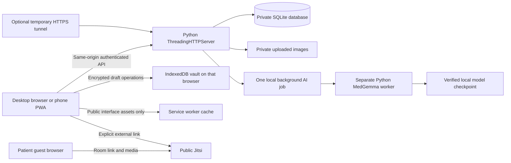

# Aarogya Drishti architecture

Aarogya Drishti is a responsive browser application and installable PWA backed by a Python standard-library server and SQLite. The application records a community oral-health care workflow and can run a separate local experimental MedGemma process. It is a prototype for synthetic-data demonstrations; a native Android/iOS wrapper and a production clinical deployment have not been built.

## Components and trust boundaries

The tunnel forwards application traffic to a loopback backend. Public Jitsi transports meeting media independently of the application tunnel. The backend creates an opaque room name for each new appointment; it does not carry or record audio/video, control the microphone, or manage guest admission.

## Source map

| Component | Files | Responsibility |
| --- | --- | --- |
| Application shell and workflow | `index.html`, `styles.css`, `app.js` | Authentication UI, navigation, registration, screening, human review, referrals, follow-ups, dashboard and appointments. |
| Longitudinal care UI | `care-records.js` | Patient stages, diagnostic/treatment/escalation histories, source-linked AI review and explicit printable summaries. Mounts within Care coordination; exposes `CareRecords.refresh()` and `CareRecords.openPatient(id)`. |
| Browser offline vault | `offline-vault.js` | Passphrase-derived authenticated encryption for queued operations in IndexedDB. Keys are held in memory while unlocked. |
| Offline oral capture | `offline-screening.js`, `offline-capture-ui.js` | Encrypted minimum patient choices and photo/note drafts, current-owner checks and explicit acknowledged synchronization. |
| References | `gallery.js`, `reference-labels.js`, `assets/reference/` | Seven project-owner supplied visual references, neutral captions and accessible full-image dialog. These static files are public and separate from protected patient uploads. |
| Backend and authentication | `app.py`, `auth_limits.py` | Routes, SQLite connections, validation, sessions, roles, upload checks, audit events and account creation. |
| Care records | `clinical_records.py` | Diagnostic, treatment, escalation, AI-review and actual generated-output records. |
| Offline upload ingestion | `offline_screenings.py` | Same-worker patient resolution, consent, image checks, idempotency receipts and transactional screening creation. |
| Experimental AI | `ai_jobs.py`, `medgemma_runtime.py`, `medgemma_worker.py`, `inference_lock.py`, `medgemma-ui.js` | Bounded background jobs, separate local inference process, same-user cross-process model lock, saved genuine text/provenance and clinician-only UI. |
| Video | `app.js`, `patient-call.html`, `patient-call.js` | App-generated opaque Jitsi room and authorized invitation handoff. A patient invitation opens the same public Jitsi room. Jitsi controls audio, camera and admission in its own tab. |
| PWA | `manifest.json`, `service-worker.js`, `icon.svg` | Standalone browser installation and cached interface/reference assets. No native package or app-store release exists. |
| Presentation and preview | `open_demo.py`, `share_demo.py`, `deploy/` | Local launch, temporary HTTPS sharing, and an unverified Docker/Caddy preview scaffold. |

The [API/database reference](API_DATABASE.md) supplies route fields, enumerations, table relationships and access rules.

## Request and storage model

The default data directory is `.private-data/`; `AAROGYA_DATA_DIR` selects another location. It contains `aarogya.sqlite3` and `uploads/`, and is excluded from source control. Models, virtual environments, account databases and secret files are also excluded. SQLite enables foreign keys and WAL mode. Uploaded patient images are retrieved through authenticated `/api/images/{screening_id}` routes rather than a public directory listing.

Accounts use the roles `health_worker`, `medical_officer`, `specialist` and `admin`. Passwords use salted scrypt hashes. The application uses signed expiring HttpOnly/SameSite cookies; HTTPS proxy requests receive the Secure attribute. The reverse proxy must correctly set and protect forwarded headers. Role and ownership checks belong to the backend; hiding a control is not authorization. Health-worker patient reads are scoped to the worker's own records. Saved raw AI text is clinical-only; a worker's journey response omits that source text.

The server limits request/image sizes, validates field lengths/enumerations/dates, and audits recorded mutations and record views. Authentication throttling and AI admission controls are process-local. There is no multi-node session/throttle coordination, immutable external audit store, completed security certification or implemented regulatory-compliance claim.

## Care progression and reporting

Diagnostics, treatments and escalations are append-only events. A progress submission includes the previous record ID; the backend verifies the same patient and record type. `series_id` identifies the first event, while `previous_id` retains the chain. Earlier entries remain unchanged. Stage summaries report the latest recorded status and event counts, including historical updates. They do not infer disease status, treatment effectiveness or a clinical outcome.

AI reviews are stored separately from generated text. Agreement, disagreement/override and insufficient-output dispositions require a genuine inference audit for the same screening. An independent assessment does not claim AI use. New successful generations store the exact source text, model, time, notice and audit reference. The inference table's `runtime_json` field retains model revision, execution configuration and truncation metadata; the API exposes these as `runtime`. Historical audit-only generations retain an explicit unavailable-source status; missing text is never reconstructed.

The printable summary is built from the authenticated selected patient's records using text nodes. It requires a direct print action and a patient-information confirmation. It contains the demonstration/advisory-only notice and creates no automatic email, upload or external transmission. A printed or saved copy leaves the application access-control boundary and needs its own handling controls.

## Experimental model execution

The installed checkpoint is `google/medgemma-1.5-4b-it` at the pinned revision documented in [MedGemma setup](../MEDGEMMA_SETUP.md). The installer checks file sizes and published checkpoint digests before the runtime considers it installed. Weights are local and not part of Git. Inference runs in a separate Python environment with local-only model loading; the worker does not download from Hugging Face while processing.

The browser submits an acknowledged job and polls its durable status. One background job is admitted per server process. The runtime also bounds actual inference concurrency and terminates an overlong worker after 300 seconds. CPU loading/generation may take several minutes and can fail for memory or timeout reasons. No fabricated progress percentage or replacement result is produced. Successful text, generation audit and job success commit together. Incomplete jobs are marked interrupted on application startup; they are not silently resumed.

The CPU configuration retains the original checkpoint in bfloat16 storage, with float32 linear/convolution/attention computation, eight intra-operation threads, one inter-operation thread, a concise prompt and a 96-new-token cap. Float32 temporary weight copies are bounded and attention mask behavior is preserved. `AAROGYA_MEDGEMMA_CPU_COMPUTE=native` selects the earlier arithmetic path; neither mode establishes clinical equivalence or validation. CUDA allows 256 tokens. No int8 quantization or reduced-image-resolution path is shipped. If output reaches its cap without an end token, the runtime marks it incomplete. Pinned dependencies and measured limits are documented in [MedGemma setup](../MEDGEMMA_SETUP.md). The fastest completed office synthetic check took 203.10 seconds end-to-end; sub-minute local inference remains unmet. Historical HTTPS integration succeeded, as recorded in [runtime evidence](../qa/async-ai-runtime-check.json).

The application is designed for one server process per database while using these job admission/recovery mechanisms. A nonblocking OS lock additionally prevents simultaneous model execution by application instances owned by the same OS user and sharing a canonical model path; it does not provide a distributed queue or multi-node job recovery. A production worker queue, warm model service or multi-process scheduler would require additional coordination. The CPU synthetic runtime record demonstrates executable inference only. It provides no clinical accuracy, calibration, safety validation or eligibility evidence.

## Offline data flow

Offline drafts use Web Crypto AES-GCM with a PBKDF2-derived key. The vault passphrase is separate from the account password. Neither the passphrase nor derived key is stored for later automatic unlock. Each browser profile, device and origin has a separate vault; changing a temporary tunnel hostname changes the browser storage origin.

When an authenticated worker loads permitted patients with the vault unlocked, the app encrypts a minimum choice list. A photo draft may reference a cached patient or the operation ID of a pending registration. Photo bytes and notes are stored inside encrypted operations, not in localStorage or the service-worker cache. The service worker caches public UI/reference assets and excludes `/api/` responses, including protected patient images.

On explicit sync, the worker signs in online, unlocks the same vault and synchronizes registrations before photos. The server resolves registration receipts for pending patient references, checks current ownership/consent, validates the photo and records a stable operation receipt. The same operation and payload can be replayed after a lost response without a duplicate screening. A different payload under the same operation ID is rejected. The client removes a photo only after a matching server acknowledgement; errors remain queued and visible.

Offline access does not provide a full copy of existing medical records, clinician writes, model inference, teleconsultation or automatic cross-device/background synchronization. Browser storage can be cleared or evicted; encryption does not guarantee retention or protect an already unlocked session. Real device durability and recovery need field testing.

## Video and media evidence

The server generates a long, opaque Jitsi room name when an authorized clinician schedules a new appointment. The join and patient-invitation actions return the same `https://meet.jit.si/...` URL while the appointment is scheduled. The schedule still labels upcoming and past appointment times. Jitsi opens in a separate tab; the app has no access to that tab's microphone, camera, admission or stream status. Older Google Meet records stay in history but do not redirect to a newly invented Jitsi room. Completing/cancelling an appointment restricts subsequent application actions but cannot revoke an already-shared public link or eject participants.

Public `meet.jit.si` requires the person starting a room to sign in. A guest can wait until the host enters. Two-way audio and video remain unverified until two people test them on separate devices and confirm speech in each direction. The app does not record audio/video or host the media. Public Jitsi is limited to fictional demonstration data.

## Hosting and optional storage operations

`share_demo.py` supplies temporary HTTPS access through a Cloudflare tunnel to the local demonstration server. It depends on the host PC and both processes remaining available. `deploy/compose.yaml` supplies Caddy and a persistent application volume, but still runs Python's development HTTP server. That scaffold has not been built/run here and does not include a private Jitsi deployment, model weights/runtime installation, production backups or clinical infrastructure. Replacing the HTTP handler with a production service requires implementation work, not merely choosing a different command.

The application does **not** encrypt server database files or uploads at rest. Optional operational protection can be prepared as follows; no such configuration is asserted to be enabled on this workstation:

1. Have the host administrator create and verify a protected encrypted volume supported by the operating system or host platform. On supported Windows systems, [BitLocker provides volume encryption](https://learn.microsoft.com/en-us/windows/security/operating-system-security/data-protection/bitlocker/). Manage recovery keys separately from the application and restrict access to the service account and authorized operators.
2. Select an application directory on that volume before starting a new isolated deployment, for example `$env:AAROGYA_DATA_DIR = 'E:\AarogyaDemoData'`. Use the actual verified encrypted mount; that example path itself enables no encryption. Existing databases/uploads need a controlled, consistent migration before switching directories.
3. Keep secrets in a protected deployment environment. HTTPS protects transport; it does not encrypt stored files or replace account/storage controls. A [Docker volume is persistent storage](https://docs.docker.com/engine/storage/volumes/), so its host backing storage and backups need separately verified protection.
4. Define an encrypted backup destination, access policy, retention and recovery owner. For a simple consistent demonstration backup, stop the application and AI worker cleanly, then copy the complete data directory to that protected destination. For online database snapshots, use the [SQLite backup API](https://www.sqlite.org/backup.html) and coordinate the uploaded-file snapshot; copying only a live WAL database file is insufficient. No scheduled backup job is supplied.
5. `backup_data.py` now supplies an operator-run stopped-server copy and isolated restore with manifest, SQLite integrity, foreign-key and referenced-image checks. See the [backup commands and limits](../README.md#backup-and-restore-rehearsal). Exercise authorized login, records and reports against the isolated restore before approving a recovery process. Do not overwrite the active demonstration database during a restore rehearsal. No automatic backup schedule or real deployment recovery rehearsal is claimed.

These are optional deployment steps, not security certification or a claim of HIPAA or other regulatory compliance. Real health information requires an independently reviewed deployment and governance process.

## Verification boundaries

Unit/API tests cover mechanisms and failure paths; they do not validate medical performance, microphone permissions, remote sound, browser/PWA installation, field accessibility or infrastructure recovery. See [evaluation mapping and demo runbook](EVALUATION_READINESS.md) for the exact supplied criteria, step-by-step demonstration and outstanding evidence.
